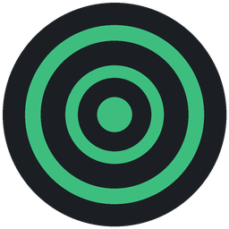
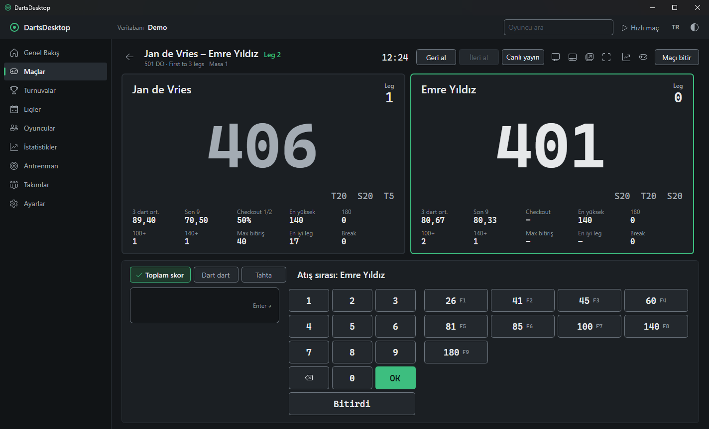
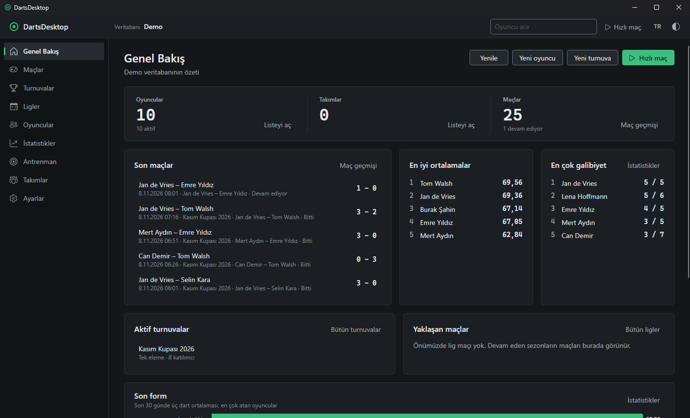
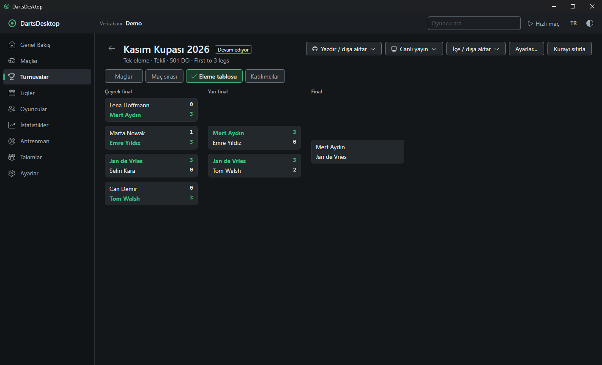
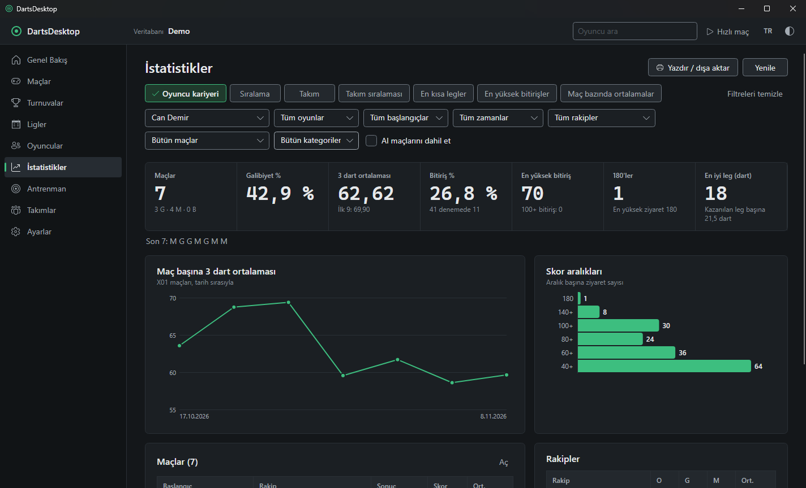
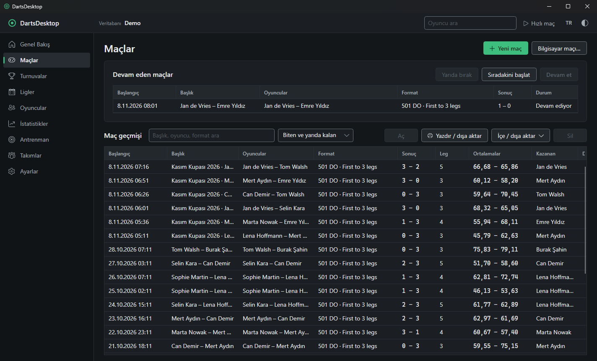

# DartsDesktop

**Dart kulüpleri, ligler ve turnuva organizatörleri için profesyonel skor ve yönetim uygulaması**

Oyuncular · Takımlar · 01 ve Cricket skor motoru · Turnuvalar · Ligler · İstatistikler · Bilgisayar rakip · Raporlar · Canlı skor

[Kurulum](#kurulum) · [İlk açılış](#ilk-açılış) · [Kullanım kılavuzu](#kullanım-kılavuzu) · [Kısayollar](#klavye-kısayolları) · [Sık sorulan sorular](#sık-sorulan-sorular) · [Telif ve açık kaynak](#telif-ve-açık-kaynak)

 

---

## Öne çıkanlar

| | |
|---|---|
| 🎯 **Skor motoru** | 301 – 10001 ve serbest başlangıç skoru, American Cricket, Cut-throat. Straight / Double / Master giriş ve çıkış, bust kontrolü, set ve leg formatları (First to, Best of, sınırsız). |
| ⌨️ **Hızlı skor girişi** | Toplam skor, dart dart (`T20 D16 25 DB M`) veya tahtaya tıklayarak. F1–F12 hazır skor tuşları, sınırsız geri al / ileri al. |
| 🏆 **Turnuvalar** | Tek ve çift eleme, round robin, grup + eleme, Pentathlon. Otomatik veya elle kura, seri başları, bye, eleme tablosu, maç sırası (Order of Play). |
| 📅 **Ligler** | Sezonlar, haftalık fikstür, ev sahibi / deplasman, puan tablosu, Super League takım maçları, oyuncu değişikliği. |
| 📊 **İstatistikler** | 3 dart ortalaması, ilk 9, checkout %, 100+ / 140+ / 180, en iyi leg, rakip bazlı karşılaştırma, sıralamalar ve grafikler. Hepsi kaydedilen her dartdan yeniden hesaplanır. |
| 🤖 **Bilgisayar rakip** | Başlangıçtan elite'e 6 seviye, kendi rakip profilleriniz, kayıtlı bir oyuncunun performansını taklit eden rakip. |
| 🎓 **Antrenman** | Bob's 27, double'larda tahta turu, süreli skor antrenmanı, antrenman günlüğü ve rekorlar. |
| 🖨️ **Raporlar** | PDF, Excel, CSV ve PNG çıktı; yazdırma, seyirci ekranı (ikinci monitör), yüzen skor penceresi. |
| 🌍 **32 dil** | Türkçe, İngilizce ve 30 Avrupa dili; çalışırken anında geçiş. Koyu, açık, yüksek kontrast ve kara tahta temaları. |
| 💾 **Güvenli veri** | Her kulüp / etkinlik ayrı bir veritabanı dosyası. Otomatik günlük yedek, şema güncellemesinden önce yedek, bütünlük kontrolü, silinen kayıtların geri getirilmesi. |
| 📡 **Canlı skor (isteğe bağlı)** | Turnuvaları ve maçları web sayfasında anlık yayınlama; internet kesilse bile sıraya alınıp sonra gönderilir. |
| ✉️ **Paylaşım** | Veritabanını ve raporları e-postayla gönderme (SMTP), FTP sunucusuna ve canlı skor sunucusuna dosya yükleme. Parolalar bu bilgisayarda şifreli saklanır. |
| 🗄️ **SQL Server** | Veritabanını dosya yerine SQL Server'da (veya LocalDB'de) tutma; mevcut veritabanını tek adımda aktarma. Yedekler yine `.dartsdb` dosyası. |
| 🏴 **Lig türleri ve bayraklar** | County ve Six Nations istatistikleri, ülke bayrakları (skor tabelasında oyuncunun yanında), lig şablonundan hazır veritabanı oluşturma. |

## Ekran görüntüleri

<table>
  <tr>
    <td width="50%">
<b>Genel bakış</b> — son maçlar, en iyi ortalamalar, aktif turnuvalar
</td>
    <td width="50%">
<b>Eleme tablosu</b> — kazananlar otomatik ilerler
</td>
  </tr>
  <tr>
    <td width="50%">
<b>Oyuncu kariyeri</b> — ortalama grafiği ve skor aralıkları
</td>
    <td width="50%">
<b>Maçlar</b> — devam eden maçlar ve maç geçmişi
</td>
  </tr>
</table>

---

## Kurulum

### Kurulum Paketlerini İndir

| Platform | Paket | Tür | Doğrudan İndirme |
|---|---|---|:---:|
| 🪟 **Windows** | `DartsDesktop.App-win-Setup.exe` | Kurulum Sihirbazı (Önerilen) | [⬇️ **İndir (81.0 MB)**](https://github.com/davutcan15081/DartsDesktopApp/raw/main/releases/DartsDesktop.App-win-Setup.exe) |
| 🪟 **Windows** | `DartsDesktop.App-win-Portable.zip` | Kurulumsuz / Taşınabilir ZIP | [⬇️ **İndir (73.7 MB)**](https://github.com/davutcan15081/DartsDesktopApp/raw/main/releases/DartsDesktop.App-win-Portable.zip) |
| 🍎 **macOS** | `DartsDesktop.App-osx-arm64.zip` | Apple Silicon (M1, M2, M3, M4 …) | [⬇️ **İndir (66.5 MB)**](https://github.com/davutcan15081/DartsDesktopApp/raw/main/releases/DartsDesktop.App-osx-arm64.zip) |
| 🍎 **macOS** | `DartsDesktop.App-osx-x64.zip` | Intel işlemcili Mac | [⬇️ **İndir (69.2 MB)**](https://github.com/davutcan15081/DartsDesktopApp/raw/main/releases/DartsDesktop.App-osx-x64.zip) |

---

### Sistem gereksinimleri

| | Windows | macOS |
|---|---|---|
| İşletim sistemi | Windows 10 veya 11 (64 bit) | Güncel macOS, Apple Silicon (M serisi) veya Intel |
| Ek yazılım | Gerekmez (.NET uygulamanın içinde) | Gerekmez (.NET uygulamanın içinde) |
| Disk | ~250 MB | ~250 MB |
| İnternet | İsteğe bağlı; canlı skor ve güncellemeler için | İsteğe bağlı; canlı skor ve güncellemeler için |
| Önerilen | 1280×720 veya üzeri ekran; skor için ikinci monitör isteğe bağlı | Aynı |

### 🪟 Windows

1. [**`DartsDesktop.App-win-Setup.exe`**](https://github.com/davutcan15081/DartsDesktopApp/raw/main/releases/DartsDesktop.App-win-Setup.exe) (Kurulum Sihirbazı) veya [**`DartsDesktop.App-win-Portable.zip`**](https://github.com/davutcan15081/DartsDesktopApp/raw/main/releases/DartsDesktop.App-win-Portable.zip) (Taşınabilir Sürüm) dosyasını indirin.
2. Çift tıklayın. Yönetici izni **gerekmez**; kurulum yalnızca sizin kullanıcınız için yapılır ve birkaç saniye sürer.
3. *"Windows bilgisayarınızı korudu"* uyarısı çıkarsa **Ek bilgi → Yine de çalıştır** seçin.
   (Kod imzalama sertifikası eklenince bu uyarı kalkar.)
4. **Masaüstü** ve **Başlat menüsü** kısayolları oluşturulur; DartsDesktop'ı buradan açın.

| | |
|---|---|
| Program klasörü | `%LOCALAPPDATA%\DartsDesktop.App` |
| Verileriniz | `%LOCALAPPDATA%\DartsDesktop` (veritabanları, yedekler, ayarlar, günlükler) |
| Kurulumsuz kullanım | [`DartsDesktop.App-win-Portable.zip`](https://github.com/davutcan15081/DartsDesktopApp/raw/main/releases/DartsDesktop.App-win-Portable.zip) dosyasını bir klasöre (ör. USB belleğe) açıp `DartsDesktop.exe`'yi çalıştırın |
| Güncelleme | **Ayarlar → Güncellemeler →** güncelleme adresini bir kez girin → **Denetle → Kur ve yeniden başlat** |
| Kaldırma | **Ayarlar → Uygulamalar → DartsDesktop → Kaldır** |

> Kaldırma ve güncelleme **verilerinize dokunmaz**. Veriler ayrı klasörde kalır; yeniden kurduğunuzda her şey yerindedir.

### 🍎 macOS

1. Mac'inize uygun paketi indirin:
   - Apple Silicon (M1, M2, M3, M4 …): [**`DartsDesktop.App-osx-arm64.zip`**](https://github.com/davutcan15081/DartsDesktopApp/raw/main/releases/DartsDesktop.App-osx-arm64.zip)
   - Intel işlemcili Mac: [**`DartsDesktop.App-osx-x64.zip`**](https://github.com/davutcan15081/DartsDesktopApp/raw/main/releases/DartsDesktop.App-osx-x64.zip)

   (Hangisi olduğunu öğrenmek için:  → **Bu Mac Hakkında** → *Yonga* veya *İşlemci* satırı.)
2. `.pkg` dosyasına çift tıklayın ve kurulum adımlarını izleyin.
3. *"Açılamıyor, geliştirici doğrulanamadı"* uyarısı çıkarsa:
   **Sistem Ayarları → Gizlilik ve Güvenlik →** sayfanın altındaki **Yine de Aç** düğmesine basın ve onaylayın.
   (Apple Developer imzası ve onayı eklenince bu adım kalkar.)
4. DartsDesktop'ı **Uygulamalar** klasöründen veya Launchpad'den açın. Dock'ta tutmak için simgeye sağ tıklayıp **Seçenekler → Dock'ta Tut** seçin.

| | |
|---|---|
| Verileriniz | `~/Library/Application Support/DartsDesktop` |
| Güncelleme | **Ayarlar → Güncellemeler** (Windows ile aynı) |
| Kaldırma | Uygulamalar klasöründen DartsDesktop'ı Çöp Sepeti'ne sürükleyin. Veriler silinmez. |

> macOS'ta klavye kısayollarında **Ctrl** yerine **⌘ Cmd** kullanılır. Skor anonsları macOS'un kendi sesleriyle yapılır.

---

## İlk açılış

DartsDesktop'ı açtığınızda varsayılan veritabanı (`Darts`) otomatik oluşturulur. Başka bir veritabanı oluşturmak veya açmak için **Ayarlar → Veritabanı** bölümünü kullanın. Uygulamanın temel özellikleri internet bağlantısı olmadan da kullanılabilir. Deneme ve aktivasyon lisansı bu sürümde etkin değildir.

---

## Kullanım kılavuzu

### 1. Oyuncuları ekleyin

**Oyuncular → Yeni oyuncu** (`Ctrl+N`). Ad, soyad, takma ad, ülke, şehir, doğum tarihi, kategori, lisans numarası ve fotoğraf girilebilir.

- **Hızlı kayıt:** Liste üstündeki kutuya adı yazıp `Enter`; form açık kalır, sıradakine geçersiniz.
- **Toplu ekleme:** **Toplu ekle…** → her satıra bir oyuncu.
- **CSV'den içe aktarma:** **CSV içe aktar…** → sütunlar otomatik eşleşir, olası kopyalar işaretlenir.
- Aynı kişi iki kez kaydedildiyse **Başka bir oyuncuyla birleştir…** geçmişi tek kayıtta toplar.

### 2. Maç başlatın

- **Hızlı maç:** Araç çubuğunda **▷ Hızlı maç** — önceki maçın ayarlarıyla dolu maç kurulumunu açar.
- **Yeni maç:** **Maçlar → Yeni maç** (`Ctrl+M`):
  1. **Oyun:** 501, 301, 701 … veya American Cricket.
  2. **Giriş / çıkış:** Straight, Double veya Master (ör. *501 Double Out*).
  3. **Format:** *First to* 3 leg, *Best of* 5 leg, set'li maç veya sınırsız.
  4. **Taraflar:** Kayıtlı oyuncu seçin ya da misafir adı yazın. Çiftler, üçlüler, 4 kişilik takımlar, karışık çiftler, handikap ve yedek oyuncu desteklenir.
  5. **Maçı başlat.**
- **Bilgisayara karşı:** Yeni maçta bir oyuncunun *Kim atıyor* seçimini bilgisayar yapın ve seviye seçin (Başlangıç → Elite) veya kendi rakip profilinizi kullanın.
- **Bilgisayar maçı…:** iki bilgisayar rakip bütün maçı hemen oynar; kurulumu **şablon** olarak kaydedebilirsiniz.

### 3. Skor girin

Maç ekranının altında üç giriş yolu vardır:

| Mod | Nasıl | Örnek |
|---|---|---|
| **Toplam skor** | Turun toplamını yazıp `Enter` veya `OK` | `100` `Enter` |
| **Dart dart** | Her dartı yazın: S/D/T + sayı, `25`/`SB`, `50`/`DB`, `M` = ıska | `T20 T20 D20` |
| **Tahta** | Dart tahtası resminde vurulan yere tıklayın | — |

- **F1–F12** hazır skorlardır (26, 41, 45, 60, 81, 85, 100, 140, 180 …); Ayarlar'dan değiştirilebilir.
- **Bitirdi** (`End`): oyuncu leg'i bitirdiğinde; uygulama kaç dart attığını ve double'a kaç dart gittiğini sorar.
- **Geri al** `Ctrl+Z`, **İleri al** `Ctrl+Y`. Yanlış girilen her tur düzeltilebilir; maç bittikten sonra da **maç görüntüleyicide** (`Ctrl+E`) düzenlenebilir.
- Ekranda: kalan skor, son 3 dart, 3 dart ortalaması, son 9 ortalaması, checkout yüzdesi ve **bitiriş önerisi**.
- **Tam ekran** `F11`, **seyirci skor ekranı** (ikinci monitör), **her zaman üstte küçük skor penceresi**, maç süresi ve sesli skor anonsları.
- Maç yarıda kalırsa **Maçlar → Devam eden maçlar → Devam et**; kaldığı darttan sürer.

### 4. Turnuva düzenleyin

1. **Turnuvalar → Yeni turnuva:** ad, tarih, yer ve format (tek eleme, çift eleme, round robin, grup + eleme, Pentathlon), maç formatı.
2. **Katılımcılar:** oyuncuları veya takımları ekleyin; seri başı verebilir, ödeme durumunu işaretleyebilirsiniz.
3. **Kura:** **Kura çek**, **Elle kura…** veya **Kör çift kurası**. Gerekirse bye'lar kendiliğinden yerleşir.
4. **Maçlar** sekmesinde bir maçı seçip **Oyna**: skor ekranında oynanır, kazanan **eleme tablosunda** otomatik ilerler. Dışarıda oynanan maçların sonucu **Sonuç gir** ile yazılabilir.
5. **Maç sırası:** masalara ve oturumlara göre otomatik sıralama; **Sıradakini başlat** (`Ctrl+Shift+Q`).
6. **Yazdır / dışa aktar:** fikstür, tablo, eleme ağacı ve sonuçlar PDF, Excel veya PNG olarak.

### 5. Lig yönetin

**Ligler → Yeni lig → Yeni sezon:** takımları ve oyuncuları seçin, haftalık fikstür kendiliğinden oluşur. Her karşılaşma için diziliş girilir, maçlar tek tek (rubber) oynanır. Puan tablosu, leg / set farkı, ertelenen maçlar ve sezon raporu otomatik güncellenir.

### 6. İstatistiklere bakın

**İstatistikler** sayfası: oyuncu kariyeri, sıralama, takım ve takım sıralaması, en kısa legler, en yüksek bitirişler, maç bazında ortalamalar. Oyun türü, tarih aralığı, rakip, kategori ve maç türüne göre filtrelenir. Bilgisayara karşı oynanan maçlar varsayılan olarak istatistiklere **katılmaz**; isterseniz dahil edebilirsiniz.

### 7. Antrenman yapın

**Antrenman:** Bob's 27, double'larda tahta turu (42 dart), süreli skor antrenmanı. Sonuçlar antrenman günlüğüne yazılır; kişisel rekorlar tutulur.

### 8. Verilerinizi yönetin

- **Ayarlar → Veritabanı:** yeni veritabanı, aç, son kullanılanlar, **Şimdi yedekle**, seçili yedeği geri yükle, bütünlük kontrolü, ZIP olarak dışa aktarma ve taşıma.
- Her kulüp veya etkinlik için ayrı bir veritabanı dosyası kullanabilirsiniz.
- Uygulama her gün ilk açılışta ve her güncellemeden önce **otomatik yedek** alır; son 30 yedek saklanır.
- Silinen oyuncular, takımlar ve maçlar geçmişte kalır, **geri getirilebilir**.

### 9. Görünüm, dil ve sesler

- **Dil:** araç çubuğundaki dil düğmesi (ör. `TR`) veya **Ayarlar → Dil**; `Ctrl+Shift+L` sıradaki dile geçer.
- **Tema:** koyu, açık, yüksek kontrast, kara tahta; `Ctrl+Shift+T`.
- **Sesler:** maç başlangıcı, 180, checkout ve maç sonu efektleri, skor anonsçusu; her efekt için kendi ses dosyanızı seçebilirsiniz.

### 10. Canlı skor (isteğe bağlı)

**Ayarlar → Canlı skor sunucusu** bölümünde hesap açın ve giriş yapın. Turnuva sayfasında **Canlı yayın** ile turnuva ve maçlar web sayfasında anlık görünür. İnternet kesilirse güncellemeler sıraya alınır ve bağlantı gelince gönderilir.

---

## Klavye kısayolları

Tüm kısayollar **Ayarlar → Klavye kısayolları** bölümünden değiştirilebilir. macOS'ta `Ctrl` yerine `⌘ Cmd` kullanılır.

| Kısayol | İşlem | | Kısayol | İşlem |
|---|---|---|---|---|
| `Ctrl+N` | Yeni oyuncu / takım / turnuva / lig | | `Ctrl+Z` | Geri al (maç ekranı) |
| `Ctrl+M` | Yeni maç | | `Ctrl+Y` | İleri al |
| `F2` | Seçili satırı düzenle | | `End` | Bitirdi (leg sonu) |
| `F5` | Yenile | | `F11` | Tam ekran |
| `Ctrl+F` | Oyuncu ara | | `F1`–`F12` | Hazır skorlar |
| `Ctrl+S` | Kaydet (pencerelerde) | | `Ctrl+Shift+S` | Canlı istatistik |
| `Ctrl+Shift+T` | Açık / koyu tema | | `Ctrl+Shift+Q` | Sıradaki maçı başlat |
| `Ctrl+Shift+L` | Dili değiştir | | `Ctrl+L` / `Ctrl+O` | En kısa legler / en yüksek bitirişler |

---

## Sık sorulan sorular

<b>Verilerim nerede, nasıl yedeklerim?</b>

Windows'ta `%LOCALAPPDATA%\DartsDesktop`, macOS'ta `~/Library/Application Support/DartsDesktop`. Uygulama her gün otomatik yedek alır. Ek güvenlik için **Ayarlar → Veritabanı → Farklı konuma yedekle…** ile bir USB belleğe veya buluta kopya alın.

<b>Başka bir bilgisayara nasıl geçerim?</b>

Eski bilgisayarda **Ayarlar → Veritabanı → ZIP olarak dışa aktar…** ile veritabanını taşıyın. Yeni bilgisayarda DartsDesktop'ı kurup ZIP'i içe aktarın.

<b>İnternet olmadan kullanabilir miyim?</b>

Evet. Maçlar, turnuvalar ve istatistikler çevrimdışı çalışır. Canlı skor yayınlama ve uygulama güncellemeleri için internet gerekir.

<b>Skor anonsçusu neden İngilizce?</b>

Dart hakemliğinde gelenek İngilizce anonstur. Anonsçu bilgisayarın yüklü İngilizce sesini kullanır; dilerseniz efektleri kendi ses dosyalarınızla değiştirebilirsiniz.

---

## Telif ve açık kaynak

DartsDesktop ticari bir yazılımdır. © 2026 DartsDesktop. Tüm hakları saklıdır.
Kullanılan açık kaynak bileşenler ve lisansları: [THIRD_PARTY_NOTICES.md](THIRD_PARTY_NOTICES.md).